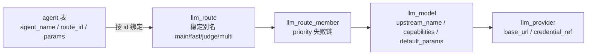

# 🔌 多模型与多服务商

> 数据库驱动的三层 LLM 配置：供应商 → 模型部署 → 路由，Agent 只绑定路由；新增模型零代码、热更新免重启（管理接口写入即时生效；直接改库不会触发刷新，见文末说明）。

---

**数据库驱动的多 Agent + 多模型服务商**，接入方式零代码：



- 🧩 **Agent**（`agent` 表）：每行一个 Agent（`agent_name`/`route_id`/`prompt`）。种子行：`general`/`deepseek`（聊天）、`multi-agent`（编排器）、`lead`（拆解器）、`aggregator`（聚合器）、`researcher`/`coder`/`analyst`/`writer`（专家）、`wms`（领域专员，工具绑定见 [wms-mcp.md](wms-mcp.md)）
- 🗺️ **路由**（`llm_route` + `llm_route_member`）：Agent 只认路由 id；成员按 `priority` 升序构成失败链，仅首个 token 前允许切换；`capabilities` 声明工具/视觉/思考/上下文窗口，启动与热更新时校验
- 🧭 **调用链**：Agent → `route_id` → 首选成员 `model_id` → `llm_provider` 端点与凭证；代码只按 id 查找，不按模型名解析
- 📈 **观测**：`llm_call_log` 记录 `route_id`/`model_id`/`provider_code`/`upstream_name`/`fallback_from_model_id`/`error_class`，可还原失败切换路径

> [!TIP]
> **新增第三方供应商（如 Moonshot、OpenRouter）零代码**：
> 1. 设置环境变量 `MOONSHOT_API_KEY`（约定规则：`<PROVIDER大写>_API_KEY`，或 `app.providers.moonshot.api-key`）
> 2. 通过管理接口登记（先校验再落库并热更新）：
>    ```text
>    POST /api/admin/providers   {"code":"moonshot","baseUrl":"https://api.moonshot.cn/v1","credentialRef":"MOONSHOT_API_KEY"}
>    POST /api/admin/models      {"providerId":<上一步返回 id>,"upstreamName":"kimi-k2","displayName":"Kimi K2","capabilities":"{\"tool_calling\":true,\"context_window\":131072}"}
>    POST /api/admin/routes      {"code":"backup","members":[{"modelId":<模型 id>,"priority":10}]}
>    PUT  /api/admin/agents/{agentId}/route   {"routeId":<路由 id>}
>    ```
> 3. 立即生效（服务端重读目录 → 全量校验 → 原子替换；校验失败保留旧配置并返回原因）
>
> **直接改库不会触发刷新**：`llm_provider` / `llm_model` / `llm_route` / `llm_route_member` 只在管理接口写入后重建内存映射，手工 SQL 修改需再调一次管理接口写入或重启服务。Agent 行（prompt / tools / route_id）走 30s 进程内缓存，最多滞后 30s；新增 Agent 行因未命中缓存而立即注册。
>
> CLI：`/provider` 查看供应商，`/provider add <provider> <apiUrl> <模型1,模型2,...>` 走同一管理接口。

> [!WARNING]
> API Key 出于安全不落库，`llm_provider.credential_ref` 只存引用名，解析规则（约定优于配置）：
> 1. `credential_ref` 本身（如 `DASHSCOPE_API_KEY`）
> 2. `app.providers.<provider>.api-key`（yaml 显式映射）
> 3. `<PROVIDER大写>_API_KEY` 环境变量（约定式回退）
>
> Key 的**装载通道**：系统级环境变量（Windows 侧 + `WSLENV` 透传进 WSL）> 仓库根 `.env.local`（启动脚本自动 source，gitignored）> 当前会话 `export`；解析优先级不受通道影响。

---

[⬅ 返回 README](../../README.md)
