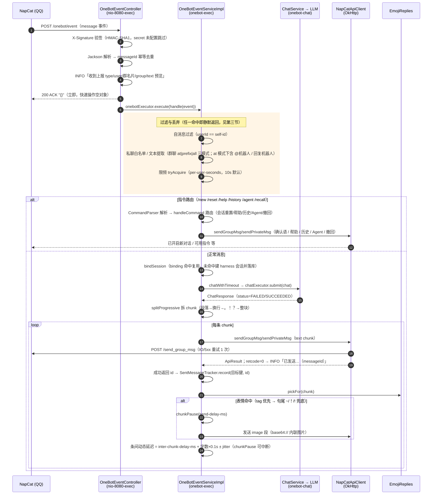

# channel 数据流与时序图

> QQ（NapCat / OneBot 11 纯 HTTP）通道专属数据流文档。主链路（API → ChatService → Agent → LLM）见 `docs/data-flow.md`，本文档只画 channel 侧：从 NapCat 上报到回复落地的完整时序、全部静默丢弃点、线程模型与发送细节。

> **2026-10 增强要点**（分支 `feat/qq-channel-enhancements`）：① 群聊「回复机器人消息」也触发；② 指令化 `/new` `/reset` `/help` `/history` `/agent` `/recall`；③ 群聊回复首条可 `@提问者`；④ `/recall` 撤回 + 发送失败自动清理；⑤ 已发消息 id 记录（`SentMessageTracker`）。触发判据与指令明细见第四节，撤回与消息记录见第五节。

## 一、线程模型（三条线程链）

| 线程链 | 归属 | 职责 | 语义 |
|---|---|---|---|
| `nio-8080-exec-*` | Tomcat | 接收上报、验签、解析、去重 | **立即 ACK**，不做任何慢事（NapCat 上报超时约 4~10s，同步处理会导致重发风暴） |
| `onebot-exec-*` | onebotExecutor（有界队列） | handle 全流程：过滤/提取/限频/建绑/调聊天/发回复 | 队列满 → log.error「异步池拒绝事件」 |
| `onebot-chat-*` | chatExecutor（8 线程） | 仅承载 `ChatService.chat` 阻塞调用 | 被 `chatWithTimeout` 120s（可配）看管；超时后 future.cancel(false)，任务继续跑完只落会话记忆 |

## 二、端到端时序图



## 三、静默丢弃点一览（「接到请求后没反应」排查表）

| # | 丢弃点 | 判定条件 | 日志 | 代码位置 |
|---|---|---|---|---|
| 1 | 上报验签失败 | X-Signature 校验不过（secret 已配置时） | **WARN**（403） | Controller.signatureValid |
| 2 | 重复上报 | messageId 已处理过 | DEBUG | Controller.onEvent |
| 3 | 异步池拒绝 | onebotExecutor 队列满 | **ERROR** | Controller.onEvent |
| 4 | 自消息过滤 | `user_id == napcat.self-id`（防自循环） | **无日志** | doHandle |
| 5 | 私聊白名单外 | `private-allow-users` 非空且不含该 uid | DEBUG | doHandle |
| 6 | 文本提取为空 | message 数组无 text 段且 raw_message 空 | **无日志** | doHandle |
| 7 | 群聊未命中触发 | mode=at 且既无 at 段指向 self-id，也未命中「回复机器人」（`reply-to-bot=false` 或入站 reply 未命中我方已发记录；self-id 未配置时 @ 判据恒假） | **无日志** | extractGroupText → atSelf/replyToSelf |
| 8 | 限频 | 同 uid 间隔 < per-user-seconds | DEBUG | doHandle |
| 9 | 聊天超时 | chatExecutor 超 chat-timeout-seconds（120s 默认） | **WARN**（放弃回复） | chatWithTimeout |
| 10 | 聊天执行异常 | LLM 链路抛异常 | **WARN** | chatWithTimeout |
| 11 | 未产出回复 | status≠SUCCEEDED 或 reply 空 | **WARN** | doHandle |
| 12 | 表情发送异常 | 表情钩子任何异常 | **WARN**（不影响文本） | sendReply |

> 4/6/7 三个点**完全无日志**——排查「收到上报但没调用大模型」时优先怀疑：群聊触发未命中（`napcat.self-id` 配置与实际 at 段 qq 是否一致；开了 `reply-to-bot` 但回复的那条并不在 `SentMessageTracker` 的 TTL 记录内）、文本提取为空。把 `logging.level.com.dark.javaHarness.channel.qq` 调到 DEBUG 可看到 2/5/8；临时排查可临时提升该包日志级别。

## 四、触发判定与指令清单（2026-10 增强）

### 群聊触发：@机器人 与 「回复机器人消息」

`napcat.group-trigger.mode=at`（默认）时，命中**任一**即触发：

1. **@机器人**：message 数组存在 `at` 段且 `data.qq == napcat.self-id`（数组缺失时兜底 `raw_message` 的 `[CQ:at,qq=self-id]`）。
2. **回复机器人消息**（新增）：`napcat.group-trigger.reply-to-bot=true`（默认 `false`）时，入站 message 数组存在 `reply` 段且其引用的消息 id 命中 `SentMessageTracker` 已发记录（TTL 内）。

两判据实现在 `EventTextParser.extractGroupText` / `atSelf` / `replyToSelf`；`prefix`（前缀）/`all`（全量）模式不受影响。

### 指令清单（`CommandParser` 纯函数）

`"/name arg"` 解析，`name` 小写化、`arg` 去首尾空白；**非 "/" 开头或 "/" 后为空 = 普通聊天**。命中指令由 `OneBotEventServiceImpl.handleCommand` 路由：

| 指令 | 行为 | 消耗 LLM |
|---|---|---|
| `/new` `/reset` | 删除当前会话 binding 行，下条消息重新建档开启新会话（记忆清空），并回确认语 | 否 |
| `/help` | 回显指令帮助文本 | 否 |
| `/history [n]` | 回显当前会话最近 n 条（默认 5；n 非法/≤0 回默认），单行截断 60 字 | 否 |
| `/agent` | 列出可用 Agent（`AgentService.agentItems()`） | 否 |
| `/agent <名>` | 按名（忽略大小写）切换当前会话 Agent；需已有会话绑定，未建档回提示 | 否 |
| `/recall` | 撤回本会话/本群最近一条机器人已发消息 | 否 |

未识别指令返回 false，交回正常聊天链路。

### 只读依赖 core `AgentService`

`/agent` 指令需要 Agent 列表与「名称 → id」映射，故 `OneBotEventServiceImpl` 构造新增只读依赖 core 接口 `com.dark.javaHarness.service.AgentService`（仅调用 `agentItems()`；**未修改 core 定义**）。会话切换仍走既有 `SessionService.switchAgent`。构造签名现为 `OneBotEventServiceImpl(ChatService, SessionService, AgentService, OneBotSessionBindingMapper, NapCatApiClient, NapCatProperties)`。

## 五、撤回与已发消息记录

### 已发消息记录 `SentMessageTracker`

- 内存 TTL（30 分钟）：`messageId → 发送时刻` + `目标键 → 最后一条 id`（目标键 `private:<uid>` / `group:<gid>`）。
- 写入：`sendSegments` 成功返回非空 id 时 `record(目标键, id)`；发送失败（id=null）忽略。
- 消费两处：① 群聊回复触发判定（入站 reply 段命中 = 回复机器人）；② `/recall` 取本目标最近一条 id。
- 容量软上限 10000，达阈值按 TTL 清扫一次；无后台线程、零外部依赖。

### 撤回与发送失败自动清理

- `/recall`：取 `lastId(目标键)`，命中则 `NapCatApiClient.deleteMsg(id)`（OneBot `delete_msg`）并回「已撤回。」；无则回「没有可撤回的消息。」。
- **发送失败自动清理**：`napcat.recall.auto-cleanup-enabled=true`（默认 `true`）时，本次回复若**已有成功分片、后续分片发送失败**，则撤回本次已发分片并停止后续发送（避免群里留半截回答）；首片即失败（无已发分片）按既有语义静默继续。

### 配置默认值落点

新增键的默认值写在 `NapCatProperties` 内（见下表）；**`application.yaml` 键的真实补录超出本轮改动范围**（本轮限定仅改 `channel/**`），待后续在 `application.yaml` 的 `napcat` 块增补。

| 键 | 类型 | 默认值（`NapCatProperties` 内） | 说明 |
|---|---|---|---|
| `napcat.group-trigger.reply-to-bot` | boolean | `false` | at 模式下，回复机器人消息是否也触发 |
| `napcat.reply.at-asker` | boolean | `false` | 群聊回复首条是否 @ 提问者 |
| `napcat.recall.auto-cleanup-enabled` | boolean | `true` | 发送失败是否撤回本次已发分片 |

## 六、发送侧细节

### 群聊首条段落（reply / @提问者 / text）

群聊回复**首条**段序：`reply`（`event.messageId` 非空即引用原消息）→ `at`（`napcat.reply.at-asker=true` 时 @ 提问者）→ `text`；私聊无 `reply`/`at` 段。@提问者默认关（防刷屏）。

### 拆分（progressive=true 时 splitProgressive，否则 splitReply 单条超长切）

层级切片，标点保留句尾，无字符硬切兜底：段落（\n\n）→ 换行（\n）→ 句读（。！？!?；;）→ 整块；`split-chars` 超限下沉下一层；`max-chunks` 防刷屏（超出部分合并进最后一条）。

### 条间动态拟人延迟

`延迟 = inter-chunk-delay-ms + chunk 字数 × delay-factor(0.1s/字) + ±jitter-range-ms 扰动`，再被 `max-delay-ms` 截断（0 = 不设上限）。首条不等待；按「即将发送的这条」取字数（模拟打完再发）。

### 表情钩子（每条 chunk 发送后，含最后一条）

1. `enabled=false` → 零行为
2. tag contains 优先（多命中随机取一）→ 无命中且句尾 `~`/`！`/`!` → cheer-emoji
3. probability 摇号（1.0 必发）→ sentEmojis < max-per-reply（0=不限）→ chunkPause(send-delay-ms) → 发 image 段

映射表：`channel/emoji-index.json`（表情名 → {path, tags}，启动加载一次，缺失/损坏空映射降级）；图片放 `channel/emojis/`（不进 git）。

## 七、持久化与外部交互

| 对象 | 类型 | 说明 |
|---|---|---|
| `onebot_session_binding` | MySQL 表 | session_key（private:uid / group:gid）→ harness session_id；仅 `/reset`、`/new` 删除对应行（过期清理是 todo 缺口） |
| `/onebot/event` | HTTP POST 入站 | NapCat httpClients 推送；恒 200 ACK（防重发风暴） |
| `/send_group_msg` `/send_private_msg` `/get_login_info` | HTTP POST 出站 | OkHttp，3s 连接/10s 读超时；IO/5xx 重试 1 次；成功返回 message_id 并记入 `SentMessageTracker`；一切失败只记日志（尽力而为） |
| `/delete_msg` | HTTP POST 出站 | OneBot 撤回接口（`NapCatApiClient.deleteMsg`）；失败只记日志不抛异常 |
| `channel/emoji-index.json` | 本地文件 | 表情映射表，启动加载一次（改后需重启） |

## 八、组件映射

```
channel/qq/
├── event/
│   ├── OneBotEventController     入站端点：验签/去重/ACK/异步分发
│   ├── OneBotEventService(Impl)  编排：过滤→提取→限频→指令路由/建绑→聊天→回复（含表情钩子）
│   ├── EventTextParser           事件文本提取（群聊 at|prefix|all 三模式）+ @机器人/回复机器人触发判据
│   ├── CommandParser             指令解析纯函数（/name arg，小写化）
│   ├── SentMessageTracker        已发消息 TTL 记录（回复触发判定 + /recall 共用）
│   └── MessageDedupCache         messageId 幂等去重（内存）
├── client/
│   ├── NapCatApiClient(Impl)     出站客户端：发送（回传 message_id）+ delete_msg + 启动自检 + 成功/失败日志
│   ├── NapCatChannelConfig       装配：napcat.enabled 条件装配 + onebotExecutor/chatExecutor
│   └── NapCatProperties          yaml 绑定（reply/emoji/rate-limit/group-trigger/recall 等）
├── reply/
│   ├── EmojiReplies              表情匹配器：JSON 映射加载 + tag/句尾判定 + image 段生成
│   ├── ReplySplitter             分段发送：progressive 层级切片 + 超长切分
│   └── UserRateLimiter           同 uid 内存滑动窗限频
└── dto/                          OneBotEvent / MessageSegment / SendMsgRequest / ApiResult
```
